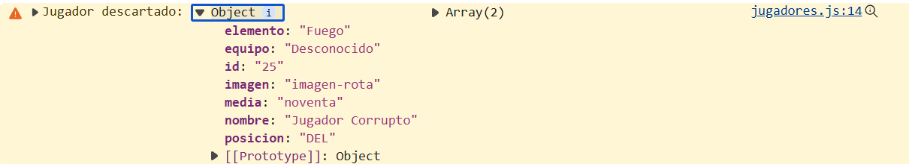

# Programación Web — Misión 4: Inazuma Draft

Misión: «Full Contact Forms»
Alumno: Izan Cuervo

## Descripción

**Inazuma Draft** es un «futdraft» de Inazuma Eleven, inspirado en al modo Draft del FIFA Ultimate Team, en versión de 7 jugadores (1 portero, 2 defensas, 2 centrocampistas y 2 delanteros). El usuario pone nombre a su equipo y a su entrenador, abre un «sobre» en cada posición del campo para que le salgan 3 candidatos al azar. A continuación, elige uno en cada hueco y nombra a uno de ellos capitán. Al guardar, el draft pasa a una clasificación ordenada por la media de sus 7 jugadores, donde se puede desplegar la formación de cada equipo o borrarlo.

- Está hecho con **React 19** y **Vite**, y revisado con **ESLint**.
- El formulario usa **React Hook Form**, y toda la validación está en un esquema de **Zod** conectado con `zodResolver`.
- Los datos van y vienen de una API local que realizé con **json-server**, y se gestionan con **TanStack Query** (`useQuery` para leer los datos obtenidos de la API y `useMutation` para guardar y borrar drafts).
- Los 50 jugadores son personajes reales de Inazuma Eleven, con su nombre, posición, elemento, equipo e imagen oficiales sacados de la enciclopedia oficial **Inazugle** de Level-5. La media de cada uno es inventada.
- El estilo está inspirado en la estética del videojuego *Inazuma Eleven: Victory Road*: cabeceras azules con un rayo, cajas blancas y etiquetas amarillas.

## Cómo ejecutarlo

Hace falta tener instalado **Node.js**. Desde la carpeta `Tema-4/Mision4`:

```bash
npm install
```

Después hay que arrancar **dos terminales**, una para la API y otra para la web:

```bash
npm run api
```

```bash
npm run dev
```

La API queda en `http://localhost:3000` (con las rutas `/jugadores` y `/drafts`) y la web en `http://localhost:5173`. La dirección de la API se lee de `VITE_API_URL`, una variables del archivo `.env`, que ya viene incluido.

Para revisar el código con ESLint:

```bash
npm run lint
```

## Cómo usarlo

1. Al abrir la página aparece **Cargando...** mientras llegan los jugadores. Si la API está apagada, sale un mensaje de error con un botón **Reintentar** que ejecutará un refetch solicitar otra petición.
2. Se escribe el **nombre del equipo** y el del **entrenador**, campos obligatorios para guardar un draft.
3. En el campo, cada posición tiene una ficha negra con sus letras (**POR**, **DEF**, **MED**, **DEL**). Al pulsarla se abre el "sobre" y salen **3 candidatos al azar** de esa posición, con su foto, su elemento y su media.
4. Se elige un jugador en cada uno de los 7 huecos.
5. En el desplegable del **capitán** solo aparecen los jugadores que ya se han elegido.
6. Al pulsar **Guardar Draft**, si falta algo o hay un error, aparece el mensaje debajo del campo correspondiente y el foco salta al primer campo con error. Si todo está bien, sale **¡Draft guardado!**, el formulario se vacía y los sobres se vuelven a cerrar para el siguiente draft con reset.
7. El draft se situa al lado derecho de la Web junto con todos tus drafrs ordenados por media (De mayor a menor) en la **clasificación** de la derecha.
8. Al pulsar un draft de la clasificación se despliega su formación (con el capitán marcado como **CAP**), y con **Borrar** se elimina.

Todo se puede usar con el teclado: Tab para moverse entre campos, flechas para elegir dentro de cada hueco y Enter para enviar.

## Funcionalidades

- **Formulario con React Hook Form:** campos de texto, 7 grupos de radios (uno por hueco) y un `<select>` para el capitán, todos con `register`.
- **Validación con Zod:** mensajes propios en cada campo y reglas cruzadas (ver abajo).
- **Carga de los jugadores de la API con `useQuery`** (los que salen en los sobres), con sus estados de carga y error y el botón de reintentar.
- **Guardar drafts con `useMutation`** (POST) y mensajes de envío, éxito y error.
- **Clasificación de drafts** con la media de cada equipo, que se actualiza sola al guardar o borrar gracias a `invalidateQueries`.
- **Borrar drafts** (DELETE), con su propio estado de «Borrando...» en cada tarjeta.
- **Sobres al azar** (extra): cada hueco empieza cerrado y, al abrirlo, sortea 3 candidatos de esa posición.
- **Formación desplegable** (extra): cada draft de la clasificación muestra sus 7 jugadores al pulsarlo.
- **Etiquetas de elemento** (extra): Fuego, Bosque, Aire y Montaña, cada una con su color, y las posiciones con los colores de los juegos (portero naranja, defensa azul, centrocampista verde y delantero rojo).
- **Bonus: validación de la respuesta de la API con Zod** (ver abajo).

### Validación con Zod

Todo está en `src/schemas/draft.js`, que es la única fuente de las reglas del formulario:

- El nombre del equipo tiene que tener entre 3 y 20 caracteres, y el del entrenador al menos 2. Con `.trim()` los espacios en blanco no cuentan.
- Cada hueco y el capitán son obligatorios, con su propio mensaje («Elige un portero», «Elige un defensa»...).
- Con `.refine` no se puede elegir **al mismo jugador dos veces** en la misma posición (los dos defensas, los dos medios o los dos delanteros). El error sale en el segundo hueco gracias a `path`.
- Otro `.refine` comprueba que **el capitán sea uno de los 7 jugadores** elegidos.

### Bonus: validación de la respuesta de la API

La validación del formulario comprueba lo que escribe el usuario, pero no lo que llega del servidor. Para eso hay un segundo esquema, `src/schemas/jugador.js`, que describe cómo tiene que ser un jugador: id de texto, nombre no vacío, posición y elemento dentro de sus valores (`z.enum`), media entera entre 1 y 99, e imagen con una URL válida.

En `src/services/jugadores.js`, cada jugador que llega de la API pasa por `esquemaJugador.safeParse()`. Los válidos se devuelven, y los que no cumplen el esquema se descartan y se avisa en la consola con el motivo exacto. Así un dato corrupto no rompe la aplicación.

Para demostrarlo, el `db.json` incluye a propósito un jugador corrupto (id 25, «Jugador Corrupto»), con la media escrita como texto (`"noventa"`) y una imagen que no es una URL. Su posición es válida (DEL), así que sin la validación aparecería entre los delanteros y rompería la media de la clasificación. Con la validación no aparece en ningún hueco, y en la consola sale el aviso:



### Accesibilidad

- Cada campo tiene su `label` unido con `htmlFor` e `id`.
- Los campos con error llevan `aria-invalid` y `aria-describedby`, que apunta al mensaje de error.
- Los errores tienen `role="alert"` y los mensajes de carga y de éxito `role="status"`.
- Cada hueco es un `fieldset` con su `legend`, así que el lector de pantalla dice de qué posición son los radios.
- El formulario lleva `noValidate` para que valide solo Zod, y el foco salta al primer campo con error.
- El botón de guardar solo se deshabilita mientras se envía.
- Los botones de los sobres y de borrar tienen `aria-label` («Abrir sobre de Portero», «Borrar el draft...»), y los de la clasificación `aria-expanded`.
- Los radios están ocultos a la vista, pero se pueden usar con el teclado, y el foco siempre es visible.

### Conceptos de la misión que se usan en el código

| Concepto | Dónde |
|---|---|
| `useForm` con `zodResolver` y `defaultValues` | `FormularioDraft.jsx` |
| `register` en inputs, radios y select | `FormularioDraft.jsx` y `HuecoJugador.jsx` (el componente recibe `register` y el nombre del campo por props) |
| `handleSubmit` y `formState.errors` | `FormularioDraft.jsx` |
| `watch` | Para saber qué jugadores hay elegidos y ofrecerlos como capitán |
| `reset` | Vacía el formulario cuando el guardado sale bien |
| Esquema de Zod con `.refine` y `path` | `schemas/draft.js` |
| `safeParse` | `services/jugadores.js` con `schemas/jugador.js` |
| `QueryClient` y `QueryClientProvider` | `main.jsx` |
| `useQuery` con claves en array | `useJugadores` (`["jugadores"]`) y `useDrafts` (`["drafts"]`) |
| Caché compartida | El formulario y la clasificación usan `useJugadores` con la misma clave, así que los jugadores se piden una sola vez |
| `useMutation`, `mutate` y `onSuccess` | `useCrearDraft` y `useBorrarDraft` |
| `invalidateQueries` | Al guardar o borrar se invalida `["drafts"]` y la clasificación se vuelve a pedir sola |
| Capa de servicios | `services/` contiene los `fetch` con `response.ok`, separados de los componentes |
| `VITE_API_URL` | `.env`, leída con `import.meta.env` en los servicios |

## Estructura de archivos

```
Tema-4/Mision4/
├── index.html                  página base
├── db.json                     datos de la API local (jugadores y drafts)
├── .env                        VITE_API_URL
├── package.json                dependencias y scripts (dev, api, lint)
├── docs/
│   └── jugador-corrupto.png    captura del bonus
└── src/
    ├── main.jsx                arranca React con el QueryClientProvider
    ├── App.jsx                 título, formulario y clasificación
    ├── components/
    │   ├── FormularioDraft.jsx   el formulario completo
    │   ├── HuecoJugador.jsx      un hueco del campo con su sobre y sus radios
    │   ├── ClasificacionDrafts.jsx   lista de drafts ordenada por media
    │   └── TarjetaDraft.jsx      un draft de la clasificación con su formación
    ├── hooks/
    │   ├── useJugadores.js     useQuery de los jugadores
    │   ├── useDrafts.js        useQuery de los drafts
    │   ├── useCrearDraft.js    useMutation para guardar
    │   └── useBorrarDraft.js   useMutation para borrar
    ├── services/
    │   ├── jugadores.js        GET de los jugadores con validación de Zod
    │   └── draftsCreados.js    GET, POST y DELETE de los drafts
    ├── schemas/
    │   ├── draft.js            esquema del formulario
    │   └── jugador.js          esquema de la respuesta de la API (bonus)
    ├── index.css               estilos generales (colores, fondo y título)
    └── App.css                 estilos del formulario, el campo y la clasificación
```

## Créditos

- *Inazuma Eleven*, sus personajes y sus imágenes pertenecen a **Level-5**. Se usan solo con fines educativos.
- Los nombres, posiciones, elementos y equipos de los jugadores, y sus imágenes, vienen del **[Inazugle](https://zukan.inazuma.jp/)**, la enciclopedia oficial de jugadores de Level-5. Las imágenes se cargan directamente desde su servidor. **Las medias son inventadas.**
- La estética está inspirada en el estilo visual del videojuego **Inazuma Eleven: Victory Road**. No se usa ninguna imagen de su web: el estadio y los demás elementos están hechos con CSS.
- Fuente **Noto Sans**, de Google Fonts.
- Apuntes de la asignatura: *Unidad 4, Formularios y peticiones HTTP* (U-tad).

## Uso de IA

He usado **Claude** (modelo Opus 5.5, en Claude Code) como asistente durante toda la misión.

Lo he usado sobre todo para que me explicara los conceptos nuevos de este tema, que todavía no se había dado en clase: cómo funcionan `register` y `handleSubmit`, para qué sirven `htmlFor` y los atributos `aria`, qué hacen el `QueryClient` y el `Provider`, la diferencia entre `useQuery` y `useMutation`, por qué hace falta `invalidateQueries`, qué es `watch`, el POST con `headers` y `body`, y métodos de JavaScript como `find`, `reduce`, `sort` y `?.`. También me revisaba el código en cada paso, me decía qué fallaba y me indicaba la página de los apuntes donde repasarlo.

**Lo que me dio hecho:**
- Los comandos para crear el proyecto y la limpieza de la plantilla de Vite;
- el `db.json`: los 24 primeros jugadores y otros 26 más, sacados del Inazugle (las medias las inventó), y el jugador corrupto del bonus;
- Me dio los cuatro `.refine` del esquema del draft;
- El esqueleto de `FormularioDraft` con el campo del equipo, y su primera corrección;
- La plantilla de los hooks `useJugadores` y `useCrearDraft`, y el servicio `guardarDrafts` (el POST);
- Una primera versión de `ClasificacionDrafts`, que después reescribí a mi manera (la función `calcularMedia` con `find` y `reduce` es mía);
- El truco de la `key` para cerrarlos después de guardar;
- El CSS (`index.css` y `App.css`), que rehízo tres veces hasta llegar al estilo del videojuego;
- Un borrador de este README, que después he revisado y reescrito.

**Algunos prompts reales:**
- «dame los refine» (después de escribir yo los campos del esquema).
- «Vale quiero que hagas el CSS, las posiciones quiero que tengan letras de colores, naranja portero, azul defensa, verde medio y rojo delantero como en los juegos de inazuma eleven...»

**Cómo he verificado lo que generaba:**
- Pasando **ESLint** y compilando con `vite build` después de cada cambio. Así detecté, por ejemplo, tres imports que VS Code había metido solo desde Zod (`is`, `id` y `set`) y que rompían el código.
- Probando en el navegador cada caso: enviar el formulario vacío, elegir al mismo defensa en los dos huecos, guardar un draft y comprobarlo en `http://localhost:3000/drafts`, borrarlo, y apagar la API para ver el mensaje de error y el botón de reintentar.
- Recorriendo el formulario solo con el teclado.
- Probando el esquema de los jugadores con `safeParse` sobre todos los del `db.json`: todos son válidos menos el corrupto.

**Lo que he hecho yo:** todo el código de React lo he escrito yo en mi editor, paso a paso, a partir de las explicaciones, los ejemplos y las correcciones de la IA, y no he avanzado a la siguiente parte hasta entender la anterior:
- **Formulario:** `FormularioDraft` completo, con `useForm`, `zodResolver`, `defaultValues`, los campos de equipo y entrenador accesibles, los 7 huecos, el selector del capitán con `watch` y el filtro de sus candidatos, el botón de guardar, los mensajes de éxito y error y el `reset`.
- **Esquemas de Zod:** los campos y mensajes de `draft.js` y el esquema `jugador.js` del bonus.
- **Servicios:** `obtenerJugadores` (con la validación de `safeParse`), `guardarDrafts`, `obtenerDrafts` y `borrarDrafts`.
- **Hooks:** `useJugadores`, `useDrafts`, `useCrearDraft` y `useBorrarDraft`, y el `QueryClientProvider` de `main.jsx`.
- **Componentes:** `HuecoJugador` con los sobres al azar, `ClasificacionDrafts` con `calcularMedia` y la ordenación, y `TarjetaDraft` con la formación desplegable y el botón de borrar.
- **Estados de la interfaz:** cargando, error con reintento, «Guardando...», «Borrando...» y «¡Draft guardado!».
- **Pruebas y correcciones** después de cada revisión, y todos los comentarios del código.

También fueron decisiones e ideas mías: el futdraft de Inazuma con 7 jugadores, usar json-server como API, la formación desplegable, los sobres al azar por posición, las etiquetas de elemento, separar los datos de cada jugador, añadir más personajes, dejar el capitán dentro del formulario, aplazar la «química» y la web oficial en la que se inspira el estilo.

## Autopsia

### Decisión 1: guardar solo los ids de los jugadores en el draft
Cada draft guarda solo los ids de sus 7 jugadores (`portero: "1"`, `defensa1: "6"`...), no los jugadores enteros. La alternativa era guardar dentro del draft el objeto completo de cada jugador, con su nombre, su media y su imagen. Así la clasificación podría mostrar la media directamente, sin buscar nada. La descarté porque repetiría los datos de cada jugador en cada draft, y si cambiara la media de un jugador en el catálogo, los drafts antiguos se quedarían con la vieja. Con los ids, los datos de cada jugador están en un solo sitio y los radios del formulario ya guardan el id, así que no hay que transformar nada antes del POST. El precio es tener que buscar cada jugador con `find` cuando se calcula la media o se pinta la formación. Como la clasificación usa la misma clave `["jugadores"]` que el formulario, esos datos ya están en la caché y no se hace ninguna petición más.

### Decisión 2: descartar los jugadores corruptos en vez de rechazar toda la respuesta
Para el bonus, el servicio valida cada jugador por separado con `safeParse` dentro de un `filter`: los válidos se usan y los corruptos se descartan con un aviso en la consola. La alternativa era validar toda la respuesta de golpe con `z.array(esquemaJugador)` y, si fallaba, lanzar un error para que TanStack Query mostrara el mensaje de error. Es más estricto, pero un solo jugador mal escrito dejaría la aplicación entera sin jugadores y no se podría hacer ningún draft. Preferí que la app siga funcionando con los datos buenos. El inconveniente es que el usuario no ve el aviso, solo aparece en la consola, así que un error en los datos podría pasar desapercibido.

### Decisión 3 (mía): el capitán dentro del formulario y no en un componente aparte
En la estructura que me propuso la IA al principio, el selector del capitán iba en su propio componente, `SelectorCapitan.jsx`, igual que cada hueco va en `HuecoJugador.jsx`. Yo lo cuestioné, porque no veía sentido en crear un componente para algo tan pequeño, y decidí dejarlo dentro de `FormularioDraft`. La diferencia con los huecos es que `HuecoJugador` se usa 7 veces, así que separarlo evita repetir 7 veces el mismo bloque de radios, mientras que el capitán solo aparece una vez y no se reutiliza en ningún sitio. Además, la lista de candidatos sale de `watch`, que pertenece al `useForm` del formulario, así que con un componente aparte habría tenido que pasarle por props los candidatos, `register` y el error sin ganar nada a cambio. El inconveniente es que `FormularioDraft` queda algo más largo. Si el selector creciera o se usara en otra parte, lo sacaría a su propio archivo.

### Lo que corregí de la IA: el cálculo de la media
Para calcular la media de cada draft, la IA me dio una versión con todo en una línea (`jugadores.find(...)?.media ?? 0` dentro de un `map`), un bucle `for` para sumar y la división escrita directamente entre `7`. Funcionaba, pero la cambié en tres puntos:
- **La búsqueda del jugador** la escribí en varias líneas, con un `if (!jugador) return 0`, porque la versión con `?.` y `??` no la entendía bien y quería poder explicarla.
- **El `for` lo cambié por un `reduce`**, que convierte el array de medias en un solo valor sin necesitar una variable que se va modificando, y que es como se recorren los arrays en el resto del proyecto (`map`, `filter`, `find`).
- **El `7` lo saqué a una constante**, `JUGADORES_POR_DRAFT`, para que no sea un número suelto sin explicación y para que, si algún día el draft pasa a 11 jugadores, solo haya que cambiarlo en un sitio.

La alternativa era dejar la versión de la IA tal cual, que era más corta. La descarté porque prefería un código que entendiera y pudiera defender línea a línea, y sin números sueltos.

### Qué mejoraría
Añadiría una sección con el catálogo de todos los personajes, una ficha de cada jugador con estadísticas (tiro, defensa, velocidad...) y una «química» que diera puntos extra a los equipos con varios jugadores del mismo elemento, como en el FUT. También quitaría el aviso de ESLint que aparece por usar `watch`, cambiándolo por `useWatch`.
